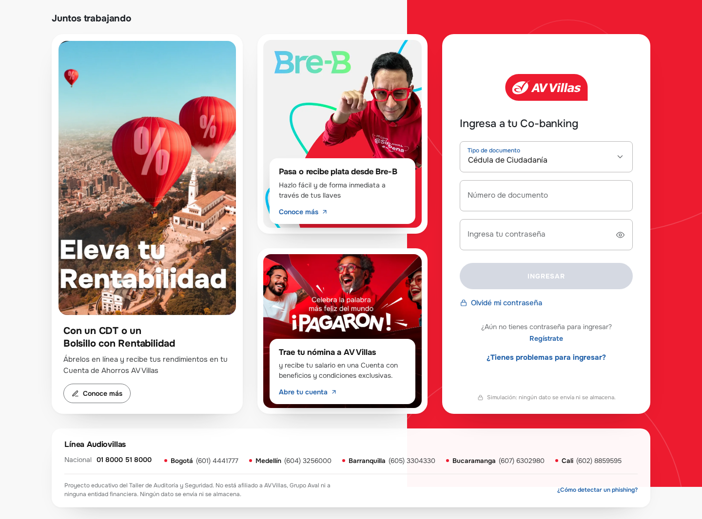
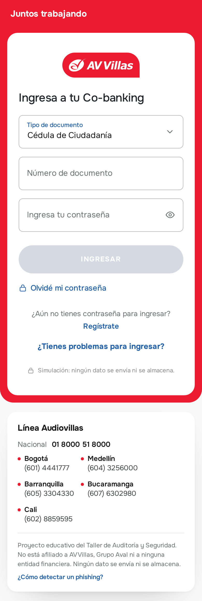
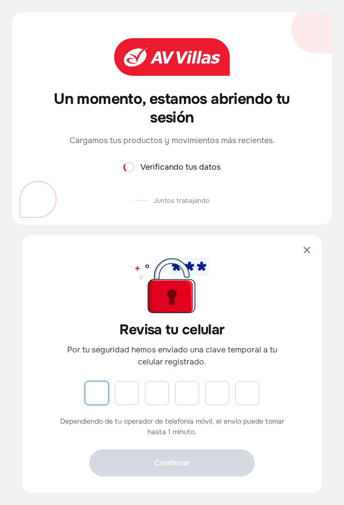
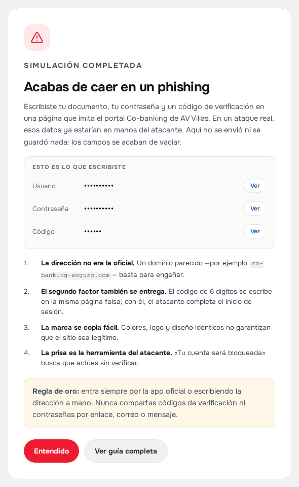

# Taller de phishing y quishing

Simulación educativa del portal **Co-banking de AV Villas** para el Taller de Auditoría y Seguridad. No envía ni almacena datos, no tiene backend y no está afiliada a la entidad.



## 📱 Móvil



## 🔐 Flujo

Al enviar el formulario se simulan la carga de sesión y la clave temporal; al final aparece el aviso con lo escrito, oculto tras **Ver**.





## Ver y publicar

```bash
python3 -m http.server 8000
```

Abre <http://localhost:8000>. Para GitHub Pages: **Settings → Pages → Deploy from a branch → main / (root)**. Luego regenera el QR:

```bash
python3 tools/make_qr.py https://tu-usuario.github.io/tu-repo/
```

## ⚠️ Aviso

Proyecto académico. Ningún dato se envía ni se almacena: el formulario se vacía y la captura del aviso se borra al cerrarlo. No la uses para captar credenciales reales.
